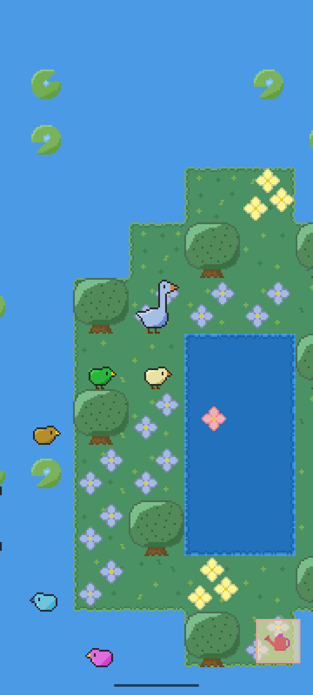
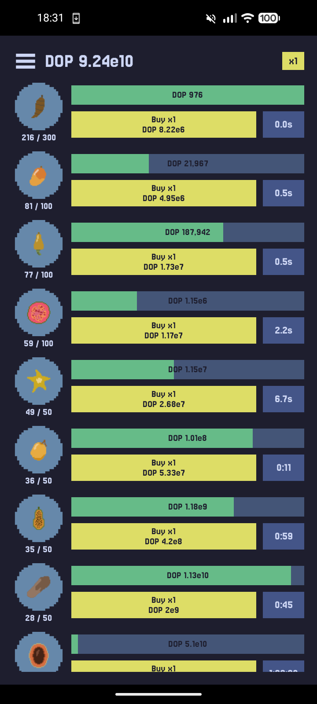
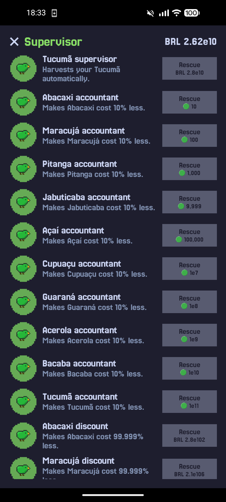
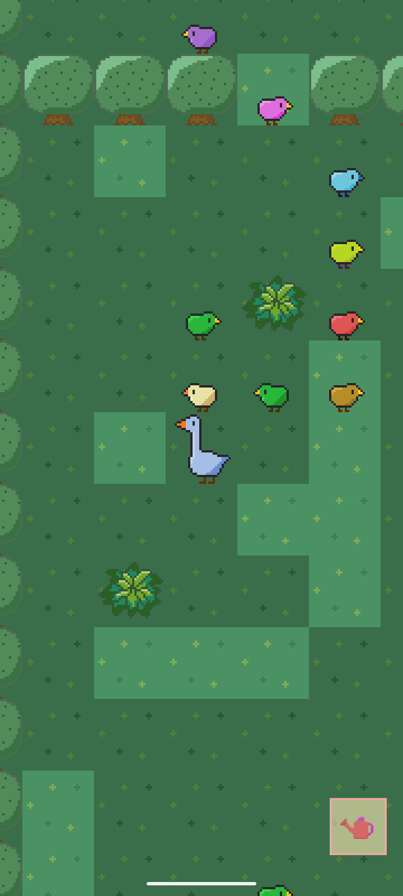
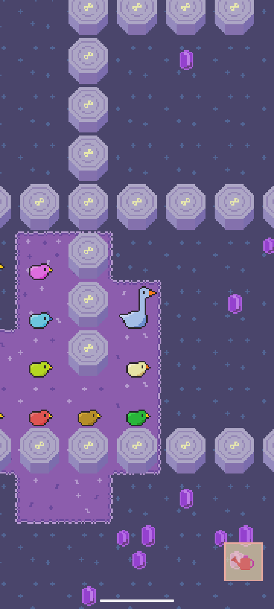

# Fikret

**An idle farm game about a goose who travels to other worlds rescuing birds.**

Buy gardens, let them grow while you're away, hire the birds you rescue to run them for you, then follow your guide birds down into the next farm.

| Lake | Farm | Supervisors | Forest | Space |
| - | - | - | - | - |
|  |  |  |  |  |

---

## Farms

Each world is a farm with ten gardens, each growing a different local fruit (the Lake grows Yuca, Mango, Cajuil, Guayaba and so on).

- Buy **x1**, **Next** (up to the next milestone) or **Max**.
- Owning 25, 50, 100 and then every further 100 of a garden doubles its speed.
- A garden unlocks once the one before it is owned.
- Progress keeps running while the app is closed and is caught up the next time you open it.

---

## Birds

Fikret rescues birds, and the birds become your staff:

- **Supervisors** automate a garden so it harvests itself.
- **Upgrades** double a garden's value or its speed.
- **Accountants** make gardens cheaper.
- **Discount managers** give a further price reduction on gardens.
- **Guide birds** are what let Fikret travel to the next farm. One per world, and they follow you around the map once hired.

---

## Ascending

Ascending restarts the Farm in exchange for **Farm points**, each worth a profit bonus. Money, gardens, supervisors, discount managers and upgrades are lost; Farm points, accountants and guide birds stay.

---

## Technical Specifications

- **Tiny:** the APK is around 120 KB.
- **No permissions:** the manifest actively strips every permission (internet, storage, camera, location, notifications and more) so none can ever sneak in.
- **No ads, no trackers, no background tasks, works fully offline.**
- **Plain Java:** no Kotlin, no AndroidX, no third-party libraries.
- **Android 5.0+** (`minSdk 21`, `targetSdk 37`).

---

## Links

- Watch the **[Promo](https://youtube.com/shorts/aLnkN12JVX0)** for a quick overview.
- Join the **[Discord Community](https://discord.gg/zFFupY8PFE)** for support and updates.

---

## Installation

  
  &nbsp;
  

